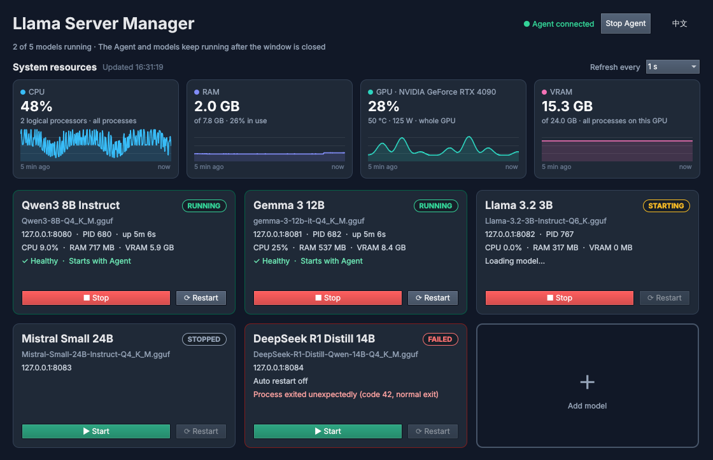
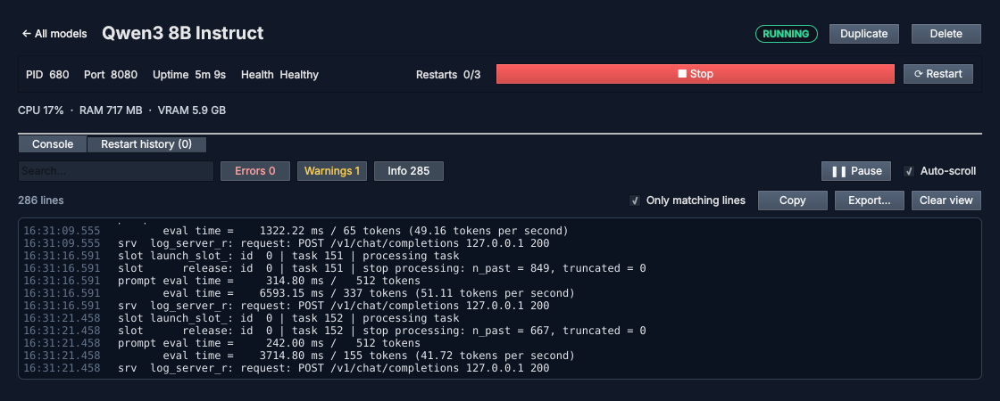
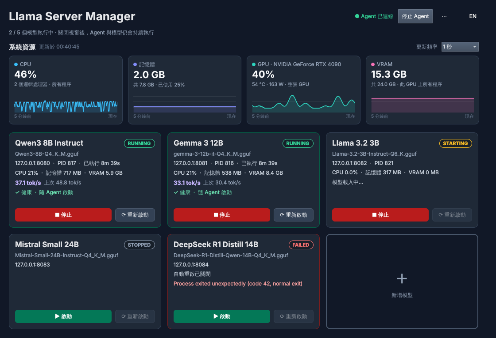

# Llama Server Manager

**A Windows desktop app for running and supervising local [llama.cpp](https://github.com/ggml-org/llama.cpp) `llama-server` instances.**

Point it at your own `llama-server.exe` and GGUF models, then start, stop, and monitor any number of models from one window. A background Agent keeps them running when the window is closed, restarts crashed or unresponsive servers, and shows CPU, RAM, GPU, and VRAM usage live.


[](LICENSE)



## Features

- **Many models, one window** — every model is a card with its state, address, PID, uptime, and one-click Start/Stop and Restart. Each model has its own profile: executable, GGUF file, context size, GPU layers, threads, parallel slots, extra arguments, and environment variables.
- **Keeps running without the GUI** — models are owned by a separate Agent process. Close the window (or let it crash) and your servers keep serving; reopen it and everything reconnects.
- **Watchdog** — HTTP health checks on `/health`, crash detection, and automatic restarts with exponential backoff and a restart limit, so a broken model does not restart forever. A manual Stop is always respected. Every failure is kept in a restart history.
- **Live resource dashboard** — system CPU and RAM plus NVIDIA GPU utilization, VRAM, temperature, and power, each with a 5-minute chart. Every model card also shows that server's own CPU, RAM, and VRAM.
- **Console** — live stdout/stderr per model with search, Error/Warning/Info filters, pause, copy, and export. Logs are also written to disk with size limits and rotation.
- **Lives in the system tray** — closing the window keeps everything running in the tray, with a status dot, per-model Start/Stop/Restart, and a notification when a model fails. Optionally start at sign-in, with your chosen models loading automatically.
- **Generation speed** — tokens per second for each model, read from llama-server's `/slots` once per second, with a 5-minute chart on the model page.
- **Ready for opencode** — give a model a stable `--alias` ID, then let the model page read `/v1/models` and `/props` and produce an `opencode.json` provider entry to copy.
- **Convenience** — duplicate a profile to try other settings, and stop all models and the Agent with one Stop Agent button.
- **English and Traditional Chinese** user interface, switchable at any time.
- **Nothing extra to install** — no Docker, Python, Ollama, or LM Studio. It uses the llama.cpp build and models you already have and never modifies them.

## Screenshots

| Console with level filters | 繁體中文介面 |
| --- | --- |
|  |  |

The screenshots use sample data produced by the test doubles in [`tests/`](tests) (a stand-in server and NVML library), not a real GPU.

## How it works

```text
llama-manager.exe  ⇄  local named pipe (JSON)  ⇄  llama-manager-agent.exe  ─┬─▶ llama-server.exe  (model A)
   Qt Quick GUI                                     background Agent         ├─▶ llama-server.exe  (model B)
                                                                             └─▶ …
```

- The **GUI** only displays state and sends commands. It starts the Agent if none is running.
- The **Agent** owns every `llama-server` process (each in its own Windows Job Object), runs the watchdog and resource sampling, and stores profiles, settings, and logs. Only one Agent runs per data directory, and it never touches `llama-server` processes it did not start.
- Arguments are passed to `llama-server` as a list, never through a shell, so paths with spaces or non-ASCII characters work.

More detail: [architecture](docs/architecture.md) · [IPC protocol](docs/ipc-protocol.md)

## Requirements

- Windows 10 or 11, x64
- A `llama-server.exe` from [llama.cpp](https://github.com/ggml-org/llama.cpp) (any backend: CPU, CUDA, Vulkan, …) and one or more `.gguf` models
- Optional: an NVIDIA GPU and driver for GPU/VRAM monitoring (NVML ships with the driver). Without it, everything except the GPU tiles works as usual.
- To build: Qt 6.5+ (MSVC x64), CMake 3.24+, and Visual Studio 2022 or 2026 with the C++ desktop workload; Inno Setup 6 for the installer

Download the installer (`…-setup.exe`) or the zip from [Releases](https://github.com/LiYuan-Lu/LlamaServerManager/releases). The zip needs no installation: extract it anywhere and run `bin\llama-manager.exe`. You can also [build the installer](#build-the-installer) or [build from source](#building-from-source) yourself.

The releases are not code-signed yet, so the first time you run them Windows SmartScreen may show "Windows protected your PC". Click **More info**, then **Run anyway**. `SHA256SUMS.txt` in each release lists the files' checksums.

## Getting started

1. Run the installer, or `llama-manager.exe` from a build. It starts the Agent in the background.
2. Click the **+** card, give the model a name, and use **Browse…** to select your `llama-server.exe` and `.gguf` file. Adjust the port, context size, GPU layers, and other options, then click **Add model**.
3. Click **▶ Start** on the card. The Agent checks the executable's `--help` output, launches it, and keeps the model in `STARTING` until `GET /health` answers 200, then shows `RUNNING`.
4. Point your client at `http://127.0.0.1:<port>` (llama-server's OpenAI-compatible API).

Click a card to open its page with the full profile, the **Console**, and the **Restart history**.

### Everyday use

| You want to… | Do this |
| --- | --- |
| Stop one model | Its **■ Stop** button. Pending automatic restarts are cancelled. |
| Close the window, keep models running | Close the window: it goes to the system tray. Click the tray icon to bring it back. |
| Exit the window completely | Tray menu or **⋯** menu → **Exit (models keep running)**. |
| Start everything when you sign in | **Start at sign-in** in the **⋯** menu or the tray menu, plus **Start automatically when the Agent starts** on the models you want. |
| Stop all models and the Agent | **Stop Agent** (top right), then confirm. Start it again with **Start Agent**. |
| Start a model whenever the Agent starts | Check **Start automatically when the Agent starts** in its profile. |
| Try different settings | **Duplicate** on the model page creates an unsaved copy on the next free port. |
| Change how often resources refresh | **Refresh every** (1–10 s) above the resource tiles. |
| Switch language | The **EN / 中文** button. |

Extra arguments are entered as a JSON array (`["--flash-attn", "on"]`) and environment variables as a JSON object (`{"CUDA_VISIBLE_DEVICES": "0"}`). Options the manager sets itself (`-m`, `-c`, `-ngl`, `-t`, `--host`, `--port`, `--parallel`, `--metrics`) cannot be overridden there.

### Watchdog defaults

With the defaults, `/health` is checked every 30 s with a 5 s timeout; 3 failures in a row mark a model `UNHEALTHY`. A model gets 600 s to load. After a crash, a failed start, or failed health checks, it is restarted after 5 s, then 10 s, 20 s, … at most 3 times in 10 minutes before it is left `FAILED`. All of this is configurable per model in its **Watchdog** section; see [docs/phase2.md](docs/phase2.md).

## Data and settings

Everything is stored per user in `%APPDATA%\LlamaServerManager\`:

| Path | Contents |
| --- | --- |
| `profiles.json` | Model profiles (up to 64), written atomically with a `.bak` of the previous version |
| `settings.json` | Agent settings, currently the resource refresh interval |
| `logs\<profile-id>\server.jsonl` | Console output, 4 MiB per file, 3 rotated files kept |
| `logs\<profile-id>\restart-history.json` | Last 50 watchdog events |

Deleting a model deletes its log folder; the model file itself is never touched. Clearing the console only clears the screen.

### Notes and limitations

- GPU values on the dashboard are for the **whole GPU**. A model's own VRAM is shown only when the driver reports it; Windows WDDM drivers usually do not, so it reads `VRAM n/a`.
- Only NVIDIA GPUs are monitored (through NVML). Other GPUs still work with llama.cpp; they are just not shown.
- The Agent refuses to start a model on a port another running model uses, but it does not check whether there is enough VRAM for all of them.
- The Agent's named pipe is limited to the current Windows user. It is not a security boundary against other programs running as that user.
- Log levels in the console are inferred from the text, since llama.cpp does not label its output.

## Building from source

Install Qt 6.5 or later with the **MSVC x64** components (Core, Network, Quick, Quick Controls, Test, Linguist Tools), CMake, and Visual Studio with the *Desktop development with C++* workload and a Windows SDK. In PowerShell, from the project root:

```powershell
$qtRoot = Read-Host "Qt MSVC x64 package directory"   # e.g. C:\Qt\6.8.0\msvc2022_64
cmake -S . -B build -G "Visual Studio 18 2026" -A x64 "-DCMAKE_PREFIX_PATH=$qtRoot"
cmake --build build --config Release --parallel
```

Use the `Visual Studio 17 2022` generator for VS 2022. If MSBuild stalls in a restricted environment, build with `-- /m:1 /nr:false` instead of `--parallel`.

### Run the tests

```powershell
$env:PATH = (Join-Path $qtRoot "bin") + ";" + $env:PATH
ctest --test-dir build -C Release --output-on-failure
```

The tests need no GPU or model: they use a small fake `llama-server` and a fake NVML library. See [docs/testing.md](docs/testing.md) for what is covered, the recorded results, and how to run the optional test against a real model.

### Build the installer

With [Inno Setup 6](https://jrsoftware.org/isinfo.php) installed (`winget install JRSoftware.InnoSetup`), one script builds a Release version, collects the Qt runtime, and produces `packaging\windows\out\LlamaServerManager-<version>-windows-x64-setup.exe` and a zip that runs without installing (`…-windows-x64.zip`, with the Visual C++ runtime DLLs included). Add `-RunTests` to build and run the test suite first:

```powershell
.\packaging\windows\build-installer.ps1 -QtRoot $qtRoot
```

The installer adds Start menu (and optionally desktop) shortcuts, installs the Visual C++ runtime when needed, can turn on start at sign-in, and closes a running copy cleanly before upgrading or uninstalling. Your profiles and logs are kept on uninstall. See [packaging/README.md](packaging/README.md).

To get just a runnable folder (any platform), install the build: Qt's deployment step copies the Qt libraries, plugins, and QML modules next to the executables.

```powershell
cmake --install build --config Release --prefix dist
```

### Translations

UI strings use Qt's `qsTr()`; translations live in [`translations/`](translations). After changing strings, refresh and edit them, then rebuild:

```powershell
cmake --build build --target llama-manager_lupdate
& (Join-Path $qtRoot "bin\linguist.exe") translations\llama-manager_zh_TW.ts
```

To add a language, add its `.ts` file to `qt_add_translations` in `CMakeLists.txt` and list it in `apps/gui/LanguageManager.cpp`.

## Project layout

```text
apps/gui/       Qt Quick GUI (QML pages and components, language switching)
apps/agent/     Agent entry point and single-instance lock
core/           Profiles, process management, watchdog, health checks, resource monitors
ipc/            JSON protocol, Agent server, GUI client, console model
tests/          Qt Test suite, fake llama-server, fake NVML library
translations/   Qt Linguist sources
packaging/      Installers per platform (Windows: Inno Setup)
docs/           Design and test documentation
```

| Document | About |
| --- | --- |
| [SPEC.md](SPEC.md) | Original specification (Traditional Chinese) |
| [docs/architecture.md](docs/architecture.md) | Processes, states, ownership, and limits |
| [docs/ipc-protocol.md](docs/ipc-protocol.md) | GUI ⇄ Agent messages |
| [docs/phase2.md](docs/phase2.md) | Watchdog and restart policy |
| [docs/phase3.md](docs/phase3.md) | Resource monitoring and console |
| [docs/phase4.md](docs/phase4.md) | System tray, start at sign-in, command line, packaging |
| [docs/testing.md](docs/testing.md) | Test coverage and results |

## Roadmap

Done: GUI and Agent (Phase 1), watchdog (Phase 2), dashboard, multiple models, and console (Phase 3), profile duplication, auto start, and Stop Agent, and desktop integration (Phase 4): system tray, start at sign-in, and the Windows installer.

Next:

- Prebuilt releases on GitHub, built by CI
- Signed release builds
- macOS app bundle and DMG, Linux packages (the tray and start-at-sign-in code already has macOS and Linux backends)

A Windows Service mode is not planned: start at sign-in covers the intended single-user setup (see [docs/phase4.md](docs/phase4.md#out-of-scope)).

## Contributing

Issues and pull requests are welcome. Please:

- Format C++ with the repository's `.clang-format` (WebKit style) and **always use braces**, even for one-line `if` bodies — see [AGENTS.md](AGENTS.md).
- Write commit messages in [Conventional Commits](https://www.conventionalcommits.org/) style (`feat:`, `fix:`, `docs:` …).
- Run the test suite before opening a pull request, and add tests for new behavior.

## License

Llama Server Manager is released under the [MIT License](LICENSE).

It is built with [Qt](https://www.qt.io/), which is used under the GNU LGPL v3 and linked dynamically; release packages must include Qt's license notices. llama.cpp and model files are not included and keep their own licenses.
